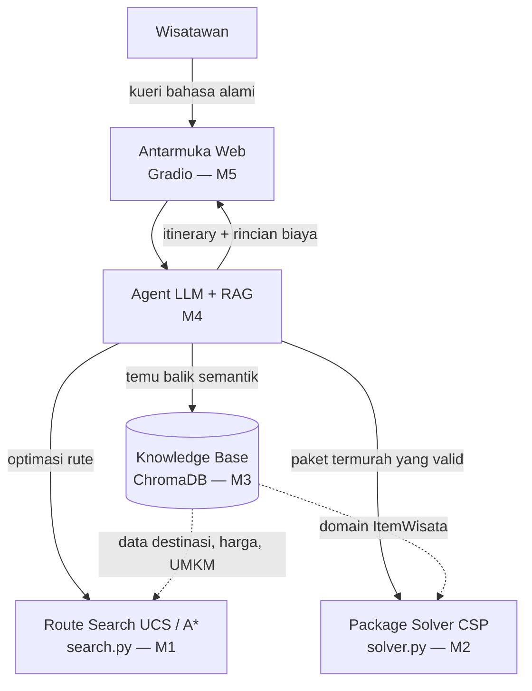

# Toba Copilot

**Enterprise AI Assistant/Copilot** untuk rekomendasi itinerary wisata personalisasi di Kawasan Danau Toba — dikembangkan untuk mata kuliah 10S3001 Kecerdasan Buatan, Institut Teknologi Del.

> ### 📊 Status & Linimasa Pengerjaan Proyek
>
> 🟢 **Milestone 1 (W02)** &nbsp;`[SELESAI]`&nbsp; : Problem Framing, PEAS, & Baseline Route Search (UCS & A*)  
> 🟢 **Milestone 2 (W04)** &nbsp;`[SELESAI]`&nbsp; : Business Constraint Optimization Problem (CSP / GAC + MRV)  
> 🟢 **Milestone 3 (W07)** &nbsp;`[SELESAI]`&nbsp; : Knowledge Base Korpus & ChromaDB Persistent Vector Search (37 Tests Passed)  
> 🟡 **Milestone 4 (W11)** &nbsp;`[NEXT]`&nbsp;&nbsp;&nbsp;&nbsp;&nbsp; : Agentic RAG Pipeline (LLM + Dynamic Retrieval + MCP Tools)  
> ⚪ **Milestone 5 (W13)** &nbsp;`[PLANNED]`&nbsp; : Interactive Web Application & Analytics Dashboard (Gradio)

## Tim — Kelompok 7

| NIM | Nama | Role |
|---|---|---|
| 12S24003 | Michael Pratama Nasution | AI Architect & Model Lead |
| 12S24027 | Grasia Simanullang | Integration & Interface Engineer |
| 12S24042 | Ventyola Rohati Napitupulu | Data & Knowledge Engineer |

## Latar Belakang Singkat

Dinas Kebudayaan dan Pariwisata Kabupaten Toba menghadapi fragmentasi informasi pariwisata, keterbatasan pencarian berbasis kata kunci, serta ketimpangan eksposur destinasi/UMKM lokal. Toba Copilot menjembatani kebutuhan personalisasi wisatawan dengan data resmi pariwisata melalui agen cerdas berbasis RAG (pemahaman bahasa alami) dan algoritma pencarian graf (optimasi rute).

## Arsitektur



## Struktur Repositori

Repositori ini disusun secara modular dan terfragmentasi berdasarkan progres setiap milestone pengembangan:

### **Milestone 1 — Baseline Route Search (UCS & A\*)**

```
Enterprise-AI-Copilot/
├── search.py                      # Baseline search Uniform Cost Search (UCS) & A*
└── test_search.py                 # Unit test search (admissibility & optimalitas A*)
```

### **Milestone 2 — Business Constraint Solver (CSP / COP)**

```
Enterprise-AI-Copilot/
├── solver.py                      # CSP / COP constraint solver (GAC + Backtracking MRV)
├── test_solver.py                 # Unit test solver (edge cases & budget limit)
├── analysis/
│   ├── sensitivity_analysis.py    # Analisis sensitivitas solver CSP (reproducible, seed 42)
│   ├── sensitivity_scale.csv      # Hasil eksperimen skala domain CSP
│   ├── sensitivity_budget.csv     # Hasil eksperimen ketatnya anggaran CSP
│   ├── scale_space_vs_nodes.png   # Grafik ruang pencarian vs node
│   └── scale_time.png             # Grafik waktu eksekusi
└── docs/
    └── milestone2_formal_model.md # Formalisasi matematis COP (X, D, C)
```

### **Milestone 3 — Enterprise Knowledge Base & Vector Semantic Search**

```
Enterprise-AI-Copilot/
├── corpus/
│   ├── manifest.csv               # Katalog metadata 12 dokumen regulasi resmi
│   ├── check_pdf.py               # Utilitas validasi kualitas PDF
│   ├── extract_pages.py           # Ekstraksi rentang halaman relevan
│   └── raw/                       # Berkas PDF sumber asli
├── data/
│   ├── corpus/                    # Korpus teks bersih 12 dokumen + dataset pariwisata
│   │   ├── D01_perda_tobasa_12_2012_retribusi_rekreasi.txt
│   │   ├── ... (12 berkas teks regulasi/SOP resmi)
│   │   ├── cleaning_report.csv    # Laporan audit pembersihan teks regulasi
│   │   ├── hackathon_tourism_clean.jsonl         # 404 record fakta destinasi
│   │   └── hackathon_tourism_cleaning_report.csv # Laporan pembersihan dataset
│   ├── chunks/                    # Potongan teks hasil word-aware chunking
│   │   ├── chunks.jsonl           # 3.308 chunk terstruktur siap indeks
│   │   ├── chunking_experiment.csv# Eksperimen grid parameter chunking
│   │   ├── chunk_stats.csv        # Statistik panjang token per sumber
│   │   └── token_distribution.png # Visualisasi kurva distribusi token
│   └── chroma_db/                 # Basis data vektor persisten ChromaDB (HNSW Cosine)
├── src/
│   ├── preprocess.py              # Rule-based text cleaner dokumen PDF
│   ├── preprocess_tourism_dataset.py # Pembersih dataset fakta pariwisata
│   ├── chunking.py                # Word-aware recursive chunker & tokenizer
│   ├── ingest.py                  # Pipeline batch embedding & indexing ChromaDB
│   ├── retriever.py               # Semantic search engine, metadata filter & guardrail
│   └── check_db.py                # Skrip inspeksi & verifikasi isi database vektor
├── tests/
│   ├── test_chunking.py           # Unit test chunking & preservasi makna
│   ├── test_preprocess.py         # Unit test pembersihan teks regulasi
│   ├── test_preprocess_tourism_dataset.py # Unit test sanitasi dataset pariwisata
│   ├── test_ingest.py             # Unit test persistensi basis data vektor & HNSW
│   └── test_retrieval.py          # Unit test temu balik semantik & guardrail
├── analysis/
│   ├── benchmark.py               # Benchmark temu balik semantik 5 kueri bisnis & metrik IR
│   ├── retrieval_benchmark.csv    # Rekapitulasi hasil evaluasi temu balik semantik
│   ├── comparative_lexical.py     # Komparasi penelusuran leksikal (TF-IDF) vs dense semantic search
│   ├── lexical_vs_dense.csv       # Bukti empiris kelemahan TF-IDF pada kueri sinonim/parafrasa
│   ├── model_comparison.py        # Komparasi model Multilingual vs English-Only (separability margin)
│   ├── multilingual_vs_english.csv# Bukti pemisahan skor 7.3x lebih tajam pada model Multilingual
│   ├── latency_benchmark.py       # Benchmark latensi pencarian HNSW ANN vs Linear Brute-Force scan
│   └── latency_benchmark.csv      # Hasil recall 100% dan proyeksi komputasi skala enterprise
└── docs/
    └── milestone3_plan.md         # Panduan, pembagian peran & roadmap eksekusi M3
```

### **Fondasi Proyek & Konfigurasi**

```
Enterprise-AI-Copilot/
├── src/certan_ai/                 # Package proyek (entry point)
├── pyproject.toml / uv.lock       # Konfigurasi dependensi (Astral uv)
├── LICENSE                        # Lisensi proyek (MIT)
└── README.md                      # Dokumentasi komprehensif sistem
```

## Formulasi Ruang Keadaan (Milestone 1)

Masalah rute itinerary dimodelkan sebagai graf berbobot $G=(V,E)$, dengan state $x=(n, V_{visited}, b_{sisa})$, aksi berpindah antar node bertetangga dalam batas anggaran, dan goal tercapai saat seluruh destinasi target sudah dikunjungi. Detail formal (X, A, T, G, C) ada di laporan Bab III.

Diselesaikan dengan dua algoritma:
- **Uniform Cost Search (UCS)** — optimal, mengekspansi berdasarkan `g(n)` murni.
- **A\*** — `f(n) = g(n) + h(n)` dengan heuristik Haversine yang diskalakan `ρ = min(bobot_edge / haversine_edge)` sehingga terbukti admissible (diuji untuk semua pasangan node dan semua kombinasi target di `test_search.py`).

> Catatan: budget adalah batasan pada `g(n)`, bukan komponen state. State yang dipakai adalah `(node, visited)`.

## Formulasi CSP (Milestone 2)

Pemilihan kombinasi paket wisata (homestay, kuliner, destinasi utama, dan destinasi UMKM) diformulasikan sebagai *Constraint Optimization Problem* (COP) untuk meminimalkan total biaya dengan mempertimbangkan batasan anggaran (budget) wisatawan serta kewajiban melibatkan minimal satu UMKM lokal.
- **Generalized Arc Consistency (GAC)**: Digunakan untuk memangkas (pruning) kandidat yang secara absolut melanggar batasan global (budget & UMKM) sebelum fase pencarian dimulai.
- **Backtracking dengan Heuristik MRV**: Memprioritaskan variabel dengan kandidat paling sedikit (*Minimum Remaining Values*), dipadukan dengan *Branch-and-Bound* untuk menjamin penemuan paket wisata termurah secara mangkus.

## Milestone 3: Basis Pengetahuan Korpus & Vector Semantic Search

Pada Milestone 3 ini dibangun memori semantik perusahaan (*Enterprise Knowledge Base*) menggunakan **ChromaDB persisten** dengan ruang metrik **Cosine Similarity** dan model embedding multibahasa **`paraphrase-multilingual-MiniLM-L12-v2`** (384 dimensi), mencakup:
- **Korpus Regulasi & SOP**: 12 dokumen regulasi resmi Danau Toba + 404 record dataset fakta destinasi dan operasional (3.308 chunk terstruktur).
- **Chunking Engine**: *Word-aware recursive chunking* dengan *sliding window overlap* teruji ilmiah.
- **Pipeline Ingestion**: Skrip batch embedding dan persistent indexing ke ChromaDB disk (`src/ingest.py`).
- **Semantic Retriever & Guardrail**: Mesin pencari semantik (`src/retriever.py`) dengan dukungan *metadata filtering* dan *guardrail threshold* empiris penolakan kueri di luar cakupan dokumen (*out-of-domain*) pada ambang batas 0.58.
- **Benchmarking & Metrik IR**: Evaluasi 5 skenario kueri bisnis (`analysis/benchmark.py`) dengan metrik $P@k$, $R@k$, MRR (*Mean Reciprocal Rank*), dan nDCG@k (*normalized Discounted Cumulative Gain*).

### 🔬 Eksplorasi Akademik Lanjutan (Materi Perkuliahan W06 & W07)

Sebagai pengayaan materi mata kuliah Kecerdasan Buatan (W06: Intelligent Document Processing & W07: Vector Embeddings / Semantic Search), proyek ini dilengkapi validasi empiris komparatif:
1. **Leksikal (TF-IDF) vs Dense Semantic Retrieval (`analysis/comparative_lexical.py`)**:
   Membuktikan kelemahan fatal penelusuran berbasis leksikal (*vocabulary mismatch*) saat kueri berupa sinonim/parafrasa (skor kemiripan jatuh ke **0.1590**), sedangkan representasi Dense Semantic berhasil menangkap esensi semantik dengan stabil (skor **0.6756**).
2. **Model Multilingual vs Monolingual English (`analysis/model_comparison.py`)**:
   Membuktikan hipotesis ilmiah (Slide W07 hal. 26) bahwa model Multilingual memiliki *separability margin* 7.3x lebih tajam (+0.3753 vs +0.0517), mencegah skor palsu tinggi pada teks Bahasa Indonesia di luar domain (*out-of-domain*).
3. **Efisiensi Komputasi & Latensi: HNSW ANN vs Linear Scan (`analysis/latency_benchmark.py`)**:
   Menguji *pure search latency* indeks graf HNSW berbanding *brute-force matrix scan* (Recall 100% pada korpus 3.308 dokumen), serta memproyeksikan efisiensi waktu logaritmik $\mathcal{O}(\log N)$ vs linear $\mathcal{O}(N \cdot d)$ dan konsumsi memori ($N \times d \times 4\text{ bytes}$) pada skala enterprise.
4. **Prinsip Intelligent Document Processing (IDP)**:
   Pembersihan artefak OCR (watermark BPS, hyphenated words, running headers) dengan tetap mengamankan kata negasi hukum (*tidak*, *bukan*, *dilarang*) serta redaksi data pribadi sensitif (PII) sebelum diindeks.

## Instalasi & Menjalankan (Astral uv)

```bash
# instal uv jika belum ada: https://docs.astral.sh/uv/
uv sync                                        # instal seluruh dependensi dari pyproject.toml
uv run python search.py                        # jalankan contoh pencarian rute (M1)
uv run python solver.py                        # jalankan contoh penyelesaian paket wisata CSP (M2)
uv run python src/ingest.py                    # jalankan pipeline ingestion ChromaDB (M3)
uv run python src/retriever.py                 # jalankan pengujian pencarian semantik & guardrail (M3)
uv run python analysis/benchmark.py            # jalankan evaluasi benchmark 5 kueri bisnis & metrik IR (M3)
uv run python analysis/comparative_lexical.py  # komparasi empiris TF-IDF vs Dense Semantic Retrieval
uv run python analysis/model_comparison.py     # validasi empiris Multilingual vs English-only model
uv run python analysis/latency_benchmark.py    # benchmark latensi & memori HNSW ANN vs Linear Scan
uv run pytest -v                               # jalankan seluruh unit test (37 tests passed)
uv run python analysis/sensitivity_analysis.py # reproduksi analisis sensitivitas M2
```

## Roadmap Proyek (5 Milestone)

| Milestone | Fokus |
|---|---|
| M1 (W02) | Problem Framing, PEAS, Baseline Search |
| M2 (W04) | Business Constraint Solver (CSP/GA) |
| M3 (W07) | Knowledge Base & Vector Search (ChromaDB) — **(saat ini)** |
| M4 (W11) | Agent Pipeline (LLM + RAG + MCP) |
| M5 (W13) | Dashboard Web Interaktif (Gradio) |


## Lisensi

Dirilis di bawah [MIT License](LICENSE).
