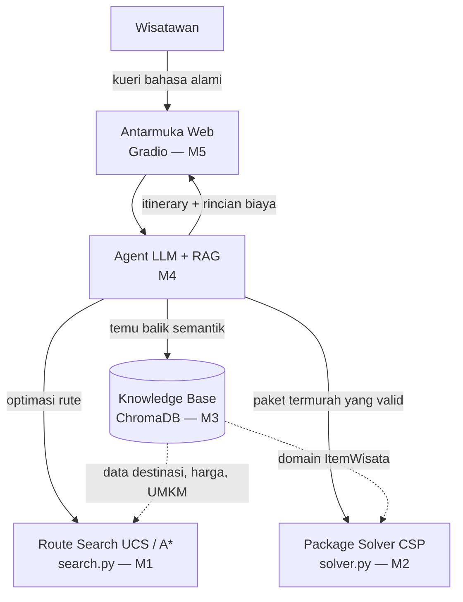

# Toba Copilot

**Enterprise AI Assistant/Copilot** untuk rekomendasi itinerary wisata personalisasi di Kawasan Danau Toba — dikembangkan untuk mata kuliah 10S3001 Kecerdasan Buatan, Institut Teknologi Del.

> **Status:** Milestone 1 (Baseline Search UCS/A\*) dan Milestone 2 (CSP Constraint Solver) selesai — Milestone 3 (Knowledge Base & Vector Search) sedang berjalan.

## Tim — Kelompok 7

| NIM | Nama | Role |
|---|---|---|
| 12S24003 | Michael Pratama Nasution | AI Architect & Model Lead |
| 12S24027 | Grasia Simanullang | Integration & Interface Engineer |
| 12S24042 | Ventyola Rohati Napitupulu | Data & Knowledge Engineer |

## Latar Belakang Singkat

Dinas Kebudayaan dan Pariwisata Kabupaten Toba menghadapi fragmentasi informasi pariwisata, keterbatasan pencarian berbasis kata kunci, serta ketimpangan eksposur destinasi/UMKM lokal. Toba Copilot menjembatani kebutuhan personalisasi wisatawan dengan data resmi pariwisata melalui agen cerdas berbasis RAG (pemahaman bahasa alami) dan algoritma pencarian graf (optimasi rute).

## Arsitektur



## Struktur Repositori

```
Enterprise-AI-Copilot/
├── search.py                      # Baseline search UCS & A* — Milestone 1
├── solver.py                      # CSP / COP constraint solver — Milestone 2
├── test_search.py                 # Unit test search (admissibility & optimalitas A*)
├── test_solver.py                 # Unit test solver (edge cases)
├── analysis/
│   ├── sensitivity_analysis.py    # Analisis sensitivitas solver (reproducible, seed 42)
│   ├── sensitivity_scale.csv      # Hasil eksperimen skala domain
│   ├── sensitivity_budget.csv     # Hasil eksperimen ketatnya anggaran
│   ├── scale_space_vs_nodes.png   # Grafik ruang pencarian vs node
│   └── scale_time.png             # Grafik waktu eksekusi
├── docs/
│   └── milestone2_formal_model.md # Formalisasi matematis CSP
├── src/certan_ai/                 # Package proyek (entry point)
├── pyproject.toml / uv.lock       # Dependensi (Astral uv)
├── LICENSE
└── README.md
```

## Formulasi Ruang Keadaan (Milestone 1)

Masalah rute itinerary dimodelkan sebagai graf berbobot $G=(V,E)$, dengan state $x=(n, V_{visited}, b_{sisa})$, aksi berpindah antar node bertetangga dalam batas anggaran, dan goal tercapai saat seluruh destinasi target sudah dikunjungi. Detail formal (X, A, T, G, C) ada di laporan Bab III.

Diselesaikan dengan dua algoritma:
- **Uniform Cost Search (UCS)** — optimal, mengekspansi berdasarkan `g(n)` murni.
- **A\*** — `f(n) = g(n) + h(n)` dengan heuristik Haversine yang diskalakan `ρ = min(bobot_edge / haversine_edge)` sehingga terbukti admissible (diuji untuk semua pasangan node dan semua kombinasi target di `test_search.py`).

> Catatan: budget adalah batasan pada `g(n)`, bukan komponen state. State yang dipakai adalah `(node, visited)`.

## Formulasi CSP (Milestone 2)

Pemilihan kombinasi paket wisata (homestay, kuliner, destinasi utama, dan destinasi UMKM) diformulasikan sebagai *Constraint Optimization Problem* (COP) untuk meminimalkan total biaya dengan mempertimbangkan batasan anggaran (budget) wisatawan serta kewajiban melibatkan minimal satu UMKM lokal.
- **Generalized Arc Consistency (GAC)**: Digunakan untuk memangkas (pruning) kandidat yang secara absolut melanggar batasan global (budget & UMKM) sebelum fase pencarian dimulai.
- **Backtracking dengan Heuristik MRV**: Memprioritaskan variabel dengan kandidat paling sedikit (*Minimum Remaining Values*), dipadukan dengan *Branch-and-Bound* untuk menjamin penemuan paket wisata termurah secara mangkus.

## Instalasi & Menjalankan (Astral uv)

```bash
# instal uv jika belum ada: https://docs.astral.sh/uv/
uv sync                 # instal seluruh dependensi dari pyproject.toml
uv run python search.py # jalankan contoh pencarian rute
uv run python solver.py # jalankan contoh penyelesaian paket wisata (CSP)
uv run pytest -v        # jalankan seluruh unit test
uv run python analysis/sensitivity_analysis.py  # reproduksi analisis sensitivitas M2
```

## Roadmap Proyek (5 Milestone)

| Milestone | Fokus |
|---|---|
| M1 (W02) | Problem Framing, PEAS, Baseline Search |
| M2 (W04) | Business Constraint Solver (CSP/GA) |
| M3 (W07) | Knowledge Base & Vector Search (ChromaDB) — **(saat ini)** |
| M4 (W11) | Agent Pipeline (LLM + RAG + MCP) |
| M5 (W13) | Dashboard Web Interaktif (Gradio) |


## Dependecy
| pip install chromadb sentence-transformers tqdm

## Lisensi

Dirilis di bawah [MIT License](LICENSE).
