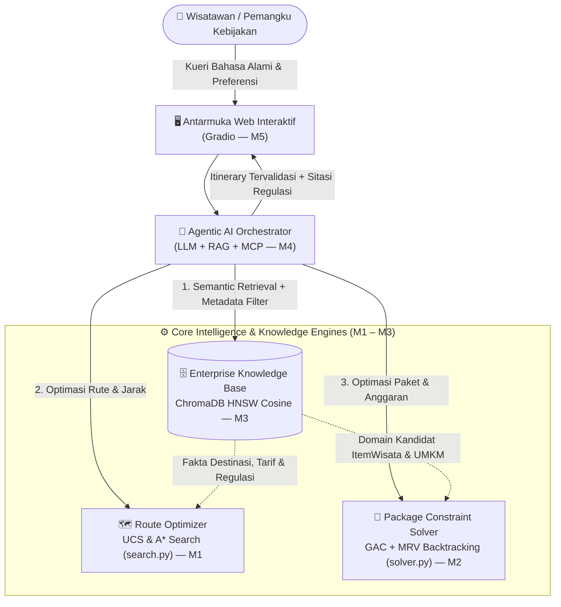

<div align="center">

# 🌊 Toba Copilot
### **Enterprise AI Assistant & Decision Support System untuk Kawasan Pariwisata Danau Toba**

[](https://www.python.org/)
[](https://docs.astral.sh/uv/)
[](https://www.trychroma.com/)
[](https://huggingface.co/sentence-transformers/paraphrase-multilingual-MiniLM-L12-v2)
[](#instalasi--menjalankan-astral-uv)
[](LICENSE)

*Dikembangkan untuk Mata Kuliah **10S3001 Kecerdasan Buatan (+P)** — Program Studi Sistem Informasi, **Institut Teknologi Del***

[**🏛️ Latar Belakang**](#latar-belakang) •
[**🧭 Arsitektur**](#arsitektur-sistem) •
[**📂 Struktur Repositori**](#struktur-repositori) •
[**🧠 Formulasi M1–M3**](#formulasi-milestone) •
[**🔬 Eksplorasi Ilmiah**](#eksplorasi-ilmiah) •
[**🚀 Quick Start**](#quick-start)

</div>

---

> ### 📊 Status & Linimasa Pengerjaan Proyek
>
> 🟢 **Milestone 1 (W02)** &nbsp;`[SELESAI]`&nbsp; : Problem Framing, PEAS, & Baseline Route Search (UCS & A*)  
> 🟢 **Milestone 2 (W04)** &nbsp;`[SELESAI]`&nbsp; : Business Constraint Optimization Problem (CSP / GAC + MRV)  
> 🟢 **Milestone 3 (W07)** &nbsp;`[SELESAI]`&nbsp; : Knowledge Base Korpus & ChromaDB Persistent Vector Search (37 Tests Passed)  
> 🟡 **Milestone 4 (W11)** &nbsp;`[NEXT]`&nbsp;&nbsp;&nbsp;&nbsp;&nbsp; : Agentic RAG Pipeline (LLM + Dynamic Retrieval + MCP Tools)  
> ⚪ **Milestone 5 (W13)** &nbsp;`[PLANNED]`&nbsp; : Interactive Web Application & Analytics Dashboard (Gradio)

---

## 👥 Tim Pengembang — Kelompok 7

| NIM | Nama Mahasiswa | Peran & Fokus Tanggung Jawab |
|:---:|---|---|
| **12S24003** | **Michael Pratama Nasution** | 🧠 **AI Architect & Model Lead** — *Arsitektur Vektor, Seleksi Model, Formulasi Matematis & Evaluasi IR* |
| **12S24027** | **Grasia Simanullang** | ⚙️ **Integration & Interface Engineer** — *Pipeline Ingestion ChromaDB, Semantic Retriever, Guardrail & Unit Testing* |
| **12S24042** | **Ventyola Rohati Napitupulu** | 📚 **Data & Knowledge Engineer** — *Kurasi Korpus Regulasi/SOP, IDP Cleaning, Sanitasi PII & Recursive Chunking* |

---

<a id="latar-belakang"></a>
## 🏛️ Latar Belakang Singkat

Dinas Kebudayaan dan Pariwisata Kabupaten Toba menghadapi tantangan berupa **fragmentasi informasi regulasi & destinasi**, keterbatasan sistem pencarian berbasis kata kunci kaku (*lexical mismatch*), serta ketimpangan eksposur terhadap **UMKM lokal**.

**Toba Copilot** hadir menjembatani kebutuhan personalisasi wisatawan dan kepatuhan regulasi daerah melalui integrasi tiga pilar kecerdasan buatan:
1. **Optimasi Rute Graf (UCS & A\*)** untuk efisiensi jarak dan waktu tempuh antar-destinasi.
2. **Penyelesaian Batasan Bisnis (CSP / COP)** untuk merangkai paket wisata paling ekonomis sesuai anggaran dan kuota wajib UMKM.
3. **Memori Semantik Korpus (ChromaDB Vector Search)** untuk temu balik informasi regulasi, standar CHSE/pondok wisata, dan fakta destinasi dalam Bahasa Indonesia secara akurat.

---

<a id="arsitektur-sistem"></a>
## 🧭 Arsitektur Sistem



---

<a id="struktur-repositori"></a>
## 📂 Struktur Repositori

Repositori ini disusun secara modular dan terfragmentasi berdasarkan progres setiap milestone pengembangan:

### **Milestone 1 — Baseline Route Search (UCS & A\*)**

```text
Enterprise-AI-Copilot/
├── search.py                      # Baseline search Uniform Cost Search (UCS) & A*
└── test_search.py                 # Unit test search (admissibility & optimalitas A*)
```

### **Milestone 2 — Business Constraint Solver (CSP / COP)**

```text
Enterprise-AI-Copilot/
├── solver.py                      # CSP / COP constraint solver (GAC + Backtracking MRV)
├── test_solver.py                 # Unit test solver (edge cases & budget limit)
├── analysis/
│   ├── sensitivity_analysis.py    # Analisis sensitivitas solver CSP (reproducible, seed 42)
│   ├── sensitivity_scale.csv      # Hasil eksperimen skala domain CSP
│   ├── sensitivity_budget.csv     # Hasil eksperimen ketatnya anggaran CSP
│   ├── scale_space_vs_nodes.png   # Grafik ruang pencarian vs node
│   └── scale_time.png             # Grafik waktu eksekusi
└── docs/
    └── milestone2_formal_model.md # Formalisasi matematis COP (X, D, C)
```

### **Milestone 3 — Enterprise Knowledge Base & Vector Semantic Search**

```text
Enterprise-AI-Copilot/
├── corpus/
│   ├── manifest.csv               # Katalog metadata 12 dokumen regulasi resmi
│   ├── check_pdf.py               # Utilitas validasi kualitas PDF
│   ├── extract_pages.py           # Ekstraksi rentang halaman relevan
│   └── raw/                       # Berkas PDF sumber asli
├── data/
│   ├── corpus/                    # Korpus teks bersih 12 dokumen + dataset pariwisata
│   │   ├── D01_perda_tobasa_12_2012_retribusi_rekreasi.txt
│   │   ├── ... (12 berkas teks regulasi/SOP resmi)
│   │   ├── cleaning_report.csv    # Laporan audit pembersihan teks regulasi
│   │   ├── hackathon_tourism_clean.jsonl         # 404 record fakta destinasi
│   │   └── hackathon_tourism_cleaning_report.csv # Laporan pembersihan dataset
│   ├── chunks/                    # Potongan teks hasil word-aware chunking
│   │   ├── chunks.jsonl           # 3.308 chunk terstruktur siap indeks
│   │   ├── chunking_experiment.csv# Eksperimen grid parameter chunking
│   │   ├── chunk_stats.csv        # Statistik panjang token per sumber
│   │   └── token_distribution.png # Visualisasi kurva distribusi token
│   └── chroma_db/                 # Basis data vektor persisten ChromaDB (HNSW Cosine)
├── src/
│   ├── preprocess.py              # Rule-based text cleaner dokumen PDF
│   ├── preprocess_tourism_dataset.py # Pembersih dataset fakta pariwisata
│   ├── chunking.py                # Word-aware recursive chunker & tokenizer
│   ├── ingest.py                  # Pipeline batch embedding & indexing ChromaDB
│   ├── retriever.py               # Semantic search engine, metadata filter & guardrail
│   └── check_db.py                # Skrip inspeksi & verifikasi isi database vektor
├── tests/
│   ├── test_chunking.py           # Unit test chunking & preservasi makna
│   ├── test_preprocess.py         # Unit test pembersihan teks regulasi
│   ├── test_preprocess_tourism_dataset.py # Unit test sanitasi dataset pariwisata
│   ├── test_ingest.py             # Unit test persistensi basis data vektor & HNSW
│   └── test_retrieval.py          # Unit test temu balik semantik & guardrail
├── analysis/
│   ├── benchmark.py               # Benchmark temu balik semantik 5 kueri bisnis & metrik IR
│   ├── retrieval_benchmark.csv    # Rekapitulasi hasil evaluasi temu balik semantik
│   ├── comparative_lexical.py     # Komparasi penelusuran leksikal (TF-IDF) vs dense semantic search
│   ├── lexical_vs_dense.csv       # Bukti empiris kelemahan TF-IDF pada kueri sinonim/parafrasa
│   ├── model_comparison.py        # Komparasi model Multilingual vs English-Only (separability margin)
│   ├── multilingual_vs_english.csv# Bukti pemisahan skor 7.3x lebih tajam pada model Multilingual
│   ├── latency_benchmark.py       # Benchmark latensi pencarian HNSW ANN vs Linear Brute-Force scan
│   └── latency_benchmark.csv      # Hasil recall 100% dan proyeksi komputasi skala enterprise
└── docs/
    └── milestone3_plan.md         # Panduan, pembagian peran & roadmap eksekusi M3
```

### **Fondasi Proyek & Konfigurasi**

```text
Enterprise-AI-Copilot/
├── src/certan_ai/                 # Package proyek (entry point)
├── pyproject.toml / uv.lock       # Konfigurasi dependensi (Astral uv)
├── LICENSE                        # Lisensi proyek (MIT)
└── README.md                      # Dokumentasi komprehensif sistem
```

---

<a id="formulasi-milestone"></a>
## 🧠 Ringkasan Teknis & Formulasi per Milestone

### Formulasi Ruang Keadaan (Milestone 1)

Masalah rute itinerary dimodelkan sebagai graf berbobot $G=(V,E)$, dengan state $x=(n, V_{\text{visited}})$, aksi berpindah antar-simpul bertetangga dalam batas anggaran, dan *goal state* tercapai saat seluruh destinasi target telah dikunjungi dengan total biaya minimum.

* **Uniform Cost Search (UCS)** — Optimal, mengekspansi simpul berdasarkan biaya kumulatif riil `g(n)` murni.
* **A\* Search** — Mengekspansi berdasarkan `f(n) = g(n) + h(n)` dengan heuristik jarak geodesik Haversine yang diskalakan menggunakan faktor $\rho = \min(\text{bobot\_edge} / \text{haversine\_edge})$ sehingga terbukti **admissible** dan **consistent** (teruji otomatis di `test_search.py`).

> [!NOTE]
> Batas anggaran (*budget*) diperlakukan sebagai kendala kelayakan transisi pada `g(n)`, sehingga representasi *state* tetap ringkas pada pasangan `(node, visited)`.

---

### Formulasi CSP / COP (Milestone 2)

Pemilihan kombinasi paket wisata (*homestay*, kuliner, destinasi utama, dan destinasi UMKM) diformulasikan sebagai *Constraint Optimization Problem* (COP) $\langle X, D, C \rangle$ untuk meminimalkan fungsi objektif biaya total dengan menjamin keterlibatan UMKM lokal:
* **Generalized Arc Consistency (GAC)** — Memangkas (*domain pruning*) kandidat yang secara absolut melanggar batasan anggaran maupun syarat wajib UMKM sebelum pohon pencarian dibangun.
* **Backtracking + Heuristik MRV & Branch-and-Bound** — Memilih variabel dengan domain tersisa terkecil (*Minimum Remaining Values*) serta memangkas cabang sub-optimal secara dinamis.

---

### Basis Pengetahuan Korpus & Vector Semantic Search (Milestone 3)

Pada Milestone 3 dibangun memori semantik perusahaan (*Enterprise Knowledge Base*) menggunakan **ChromaDB persisten** dengan indeks graf **HNSW (Cosine Similarity)** dan model **SBERT `paraphrase-multilingual-MiniLM-L12-v2`** (384 dimensi):
* **Korpus Regulasi & SOP Resmi**: 12 dokumen hukum/regulasi kepariwisataan kawasan Danau Toba (`D01`–`D12`) + 404 record dataset fakta destinasi dan fasilitas (total **3.308 chunk** terindeks).
* **Word-Aware Recursive Chunker**: Memotong teks berdasarkan hierarki batas paragraf, kalimat, dan kata dengan *sliding window overlap* tanpa memenggal kata atau menghilangkan kata negasi hukum.
* **Semantic Retriever & Out-of-Domain Guardrail**: Mendukung *metadata filtering* (`kategori`, `source_type`, `doc_id`) dan ambang batas empiris terkalibrasi ($\tau = 0.58$) untuk menolak kueri di luar domain pariwisata Toba.
* **Evaluasi IR Komprehensif**: Diukur menggunakan metrik **Precision@k**, **Recall@k**, **MRR** (*Mean Reciprocal Rank*), dan **nDCG@k** (*normalized Discounted Cumulative Gain*).

<details>
<summary>📊 <b>Klik untuk melihat Tabel Hasil Benchmark 5 Kueri Bisnis (Milestone 3)</b></summary>
<br/>

| ID | Skenario Kueri Uji Bisnis | Top-1 Similarity | Status Guardrail ($\tau=0.58$) | $P@3$ | $R@3$ | $\text{MRR}$ | $\text{nDCG@3}$ |
|:---:|---|:---:|:---:|:---:|:---:|:---:|:---:|
| **Q1** | *Exact Match* — Tarif retribusi tempat rekreasi & olahraga | `0.7548` | ✅ Lolos (In-Domain) | `1.00` | `1.00` | `1.00` | `1.00` |
| **Q2** | *Parafrasa/Sinonim* — Aturan kamar penginapan homestay warga | `0.6756` | ✅ Lolos (In-Domain) | `1.00` | `1.00` | `1.00` | `1.00` |
| **Q3** | *Metadata Filter* — Rekomendasi wisata pantai pesisir Toba | `0.7454` | ✅ Lolos (In-Domain) | `1.00` | `1.00` | `1.00` | `1.00` |
| **Q4** | *Kueri Ambigu* — Tempat makan dan aturan kebersihan | `0.6377` | ✅ Lolos (In-Domain) | `1.00` | `1.00` | `1.00` | `1.00` |
| **Q5** | *Out-of-Domain* — Rumus turunan kalkulus & bursa transfer bola | `0.3845` | 🛡️ **Ditolak Guardrail** | `1.00`* | `1.00`* | — | — |

*\*Kueri Q5 berhasil ditolak sepenuhnya oleh sistem guardrail (True Negative = 100%).*

</details>

---

<a id="eksplorasi-ilmiah"></a>
## 🔬 Eksplorasi Akademik Lanjutan (Materi Perkuliahan W06 & W07)

Sebagai pengayaan materi perkuliahan **Minggu 06 (Intelligent Document Processing / OCR)** dan **Minggu 07 (NLP Evolution, Vector Embeddings & Vector Store)**, proyek ini menyertakan empat pembuktian empiris:

<details open>
<summary><b>1. Komparasi Penelusuran Leksikal (TF-IDF) vs Dense Semantic Search</b> (<code>analysis/comparative_lexical.py</code>)</summary>
<br/>

Menguji secara langsung keterbatasan model leksikal (*Bag-of-Words*) terhadap fenomena *vocabulary mismatch*:
* Pada kueri harfiah (*exact keyword*), baik TF-IDF (`0.6120`) maupun Dense Vector (`0.7548`) berhasil menemukan dokumen Perda Retribusi.
* Namun pada **kueri parafrasa/sinonim**, skor TF-IDF jatuh ke **`0.1590`** (gagal mengenali sinonim *"tempat menginap warga"* $\leftrightarrow$ *"pondok wisata"*), sedangkan **Dense Semantic Retrieval** tetap stabil di **`0.6756`**.

</details>

<details>
<summary><b>2. Validasi Model Multilingual vs Monolingual English — Slide W07 Hal. 26</b> (<code>analysis/model_comparison.py</code>)</summary>
<br/>

Membuktikan secara matematis mengapa teks Bahasa Indonesia wajib menggunakan model embedding multibahasa:

| Metrik Evaluasi | `paraphrase-multilingual-MiniLM-L12-v2` | `all-MiniLM-L6-v2` (English-Only) |
|---|:---:|:---:|
| Rata-rata Skor Kueri **In-Domain** | `0.6243` | `0.5623` |
| Rata-rata Skor Kueri **Out-of-Domain (OOD)** | `0.2490` | `0.5107` |
| **Separability Margin ($\Delta$)** | **`+0.3753`** | **`+0.0517`** |

> [!IMPORTANT]
> Model **Multilingual** memberikan margin pemisahan kelas **7.3x lipat lebih tajam** (`+0.3753` vs `+0.0517`), sehingga ambang batas *guardrail* `0.58` dapat memisahkan kueri sah dan kueri luar domain tanpa tumpang tindih (*zero false-positive*).

</details>

<details>
<summary><b>3. Benchmark Latensi & Skalabilitas Memori: HNSW ANN vs Brute-Force Scan</b> (<code>analysis/latency_benchmark.py</code>)</summary>
<br/>

Mengukur *pure search time*, akurasi *recall*, dan proyeksi kompleksitas $\mathcal{O}(\log N)$ graf HNSW berbanding $\mathcal{O}(N \cdot d)$ *exact linear scan* pada korpus vektor 384 dimensi (`float32`):

| Skala Korpus ($N$ Dokumen) | Linear Brute-Force $\mathcal{O}(N \cdot d)$ | ChromaDB HNSW $\mathcal{O}(\log N)$ | Recall@5 HNSW | Estimasi RAM Index |
|---|:---:|:---:|:---:|:---:|
| **$N = 3.308$ (Korpus Aktual)** | `0.35 ms` | `3.29 ms` | **100.00%** | `~8.48 MB` |
| **$N = 10.000$** *(Proyeksi)* | `1.06 ms` | `3.74 ms` | ~99–100% | `~25.6 MB` |
| **$N = 100.000$** *(Proyeksi)* | `10.62 ms` | `4.67 ms` | ~98–99% | `~256.3 MB` |
| **$N = 1.000.000$** *(Skala Enterprise)* | **`106.21 ms`** | **`5.61 ms`** | ~95–98% | `~2.56 GB` |

</details>

<details>
<summary><b>4. Prinsip Intelligent Document Processing (IDP) & Redaksi PII — Materi W06</b> (<code>src/preprocess*.py</code>)</summary>
<br/>

* **Sanitasi Artefak OCR & Layout**: Menghapus *watermark* berulang katalog BPS, menyambung kata terpenggal tanda hubung (*hyphenation*), dan membersihkan *running headers/footers* tanpa merusak judul Pasal regulasi.
* **Preservasi Kata Negasi Hukum**: Memastikan kata krusial seperti `tidak`, `bukan`, `dilarang`, dan `tanpa` tidak pernah terhapus oleh *stopword removal* agar arti pasal hukum tidak terbalik.
* **Perlindungan Privasi (PII Redaction)**: Menghapus identitas pengulas serta menyamarkan nomor telepon dan alamat surel pada dataset ulasan pariwisata sebelum masuk ke basis data vektor publik.

</details>

---

<a id="quick-start"></a>
<a id="instalasi--menjalankan-astral-uv"></a>
## 🚀 Instalasi & Menjalankan (Astral uv)

Pastikan [**Astral uv**](https://docs.astral.sh/uv/) telah terpasang di perangkat Anda, kemudian jalankan perintah berikut dari direktori utama proyek:

```bash
# 1. Sinkronisasi seluruh dependensi proyek (Python 3.11+)
uv sync

# 2. Eksekusi Modul Milestone 1 (Route Search) & Milestone 2 (CSP Solver)
uv run python search.py                        # optimasi rute wisata UCS & A* (M1)
uv run python solver.py                        # optimasi paket wisata CSP GAC + MRV (M2)
uv run python analysis/sensitivity_analysis.py # reproduksi grafik sensitivitas CSP (M2)

# 3. Eksekusi Pipeline Milestone 3 (Knowledge Base & Vector Search)
uv run python src/ingest.py                    # batch embedding & indexing 3.308 chunk ke ChromaDB
uv run python src/check_db.py                  # verifikasi integritas koleksi & metrik HNSW cosine
uv run python src/retriever.py                 # demo pencarian semantik, filter metadata & guardrail

# 4. Eksekusi Benchmark & Eksperimen Akademik (W06 & W07)
uv run python analysis/benchmark.py            # benchmark 5 kueri bisnis (P@k, R@k, MRR, nDCG@k)
uv run python analysis/comparative_lexical.py  # eksperimen komparasi TF-IDF vs Dense Retrieval
uv run python analysis/model_comparison.py     # eksperimen Multilingual vs Monolingual English
uv run python analysis/latency_benchmark.py    # benchmark latensi & memori HNSW ANN vs Brute-Force

# 5. Pengujian Unit Otomatis (Pytest)
uv run pytest -v                               # jalankan 37 unit tests Milestone 3
uv run pytest test_search.py test_solver.py -v # jalankan 22 unit tests Milestone 1 & 2
```

---

<div align="center">

📄 Dirilis di bawah lisensi [**MIT License**](LICENSE) • **Kelompok 7 — 10S3001 Kecerdasan Buatan, Institut Teknologi Del (2026)**

</div>
