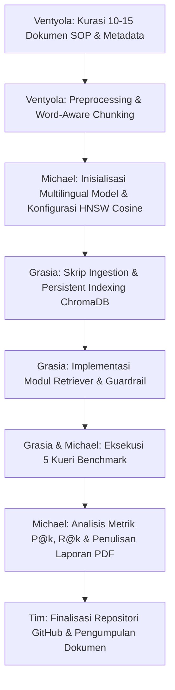

# Panduan Pengerjaan & Pembagian Peran Milestone 3 (W07)
**Mata Kuliah:** 10S3001 – Kecerdasan Buatan (+P) | Gasal 2026/2027  
**Proyek:** Toba Copilot (Enterprise AI Assistant & Vector Semantic Search)  
**Judul Tugas:** Pembangunan Basis Pengetahuan Korpus & Vector Semantic Search  
**Bobot Penilaian:** 9.0% Komponen Proyek (2.7% Nilai Akhir Semester)  

---

## 1. Pemahaman Singkat Milestone 3

Milestone 3 berfokus pada pembangunan memori semantik perusahaan (*Enterprise Knowledge Base*) menggunakan basis data vektor **ChromaDB**. Sistem ini mengonversi korpus regulasi, standar operasional prosedur (SOP), dan kebijakan pariwisata Danau Toba ke dalam bentuk vektor padat (*dense vector embeddings*) untuk mendukung temu balik informasi semantik (*semantic retrieval*) yang akurat serta menjadi fondasi sistem *Retrieval-Augmented Generation* (RAG).

### Komponen Rubrik Penilaian (Skala 100)
1. **Kualitas Data Korpus & Prapemrosesan (25%):**
   * Korpus representatif (minimal 10–15 dokumen SOP/regulasi bisnis).
   * Pembersihan teks rapi dan terstruktur (tidak merusak semantik/aturan).
   * Strategi *chunking* (*size* & *overlap*) memiliki landasan dan justifikasi ilmiah.
2. **Pipeline Embedding & Vector Store ChromaDB (45%):**
   * Pemilihan model *Sentence-Transformers* tepat (multilingual untuk teks Bahasa Indonesia).
   * Penyimpanan berbasis disk/persisten (`chromadb.PersistentClient`).
   * Konfigurasi ruang metrik HNSW secara eksplisit menggunakan *Cosine Similarity* (`{"hnsw": {"space": "cosine"}}`).
   * Struktur *metadata* tersimpan lengkap untuk mendukung *metadata filtering* / *hybrid search*.
3. **Akurasi & Analisis Temu Balik Semantik (30%):**
   * Kueri semantik berhasil menarik dokumen target dengan skor *Cosine Similarity* tinggi.
   * Uji coba minimal 5 kueri bisnis (kueri relevan, kueri sinonim/parafrasa, dan kueri *out-of-domain*).
   * Penanganan kueri luar domain teruji presisi melalui mekanisme ambang batas (*guardrail threshold*).
   * Analisis metrik temu balik: $P@k$ (*Precision@k*) dan $R@k$ (*Recall@k*).

---

## 2. Poin Kunci & Jebakan Teknis (Berdasarkan Materi Minggu 07)

* **Jarak Bawaan ChromaDB Bukan Cosine:**  
  ChromaDB secara *default* menggunakan metrik jarak kuadrat Euclidean (*squared* $L_2$). Koleksi **wajib** dikonfigurasi eksplisit ke ruang *cosine*:
  ```python
  collection = client.get_or_create_collection(
      name="toba_knowledge_base",
      configuration={"hnsw": {"space": "cosine"}}
  )
  ```
  Pada ruang jarak *cosine*, skor kemiripan dihitung dengan rumus:
  $$\text{Similarity} = 1 - \text{Distance}$$
* **Model Multilingual vs Monolingual English:**  
  Model bahasa Inggris murni (seperti `all-MiniLM-L6-v2`) memberikan skor kesamaan tinggi secara tidak wajar pada teks Bahasa Indonesia di luar domain (tidak memiliki *separability* yang baik). Gunakan model multibahasa resmi seperti `paraphrase-multilingual-MiniLM-L12-v2` agar pemisahan kueri sah dan kueri luar domain menjadi signifikan.
* **Stopword Removal Hati-hati:**  
  Menghapus kata-kata negasi seperti *"tidak"*, *"tanpa"*, atau *"dilarang"* dari dokumen regulasi/SOP akan membalikkan makna aturan secara fatal. Prapemrosesan harus mempertahankan konteks kalimat.
* **Pencarian Cepat ANN (HNSW):**  
  *Hierarchical Navigable Small World* (HNSW) menggantikan pencarian linear $O(N)$ menjadi skala logaritmik $O(\log N)$, menukar sedikit ketelitian demi kecepatan penelusuran di jutaan dimensi vektor.
* **Ambang Batas (*Guardrail Threshold*):**  
  Nilai ambang penolakan kueri di luar domain (misal $0.15 - 0.25$) harus diperoleh melalui kalibrasi uji empiris, bukan sekadar tebakan.

---

## 3. Pembagian Tugas Berdasarkan Peran Tim

### Tim Pengembang — Kelompok 7

| NIM | Nama | Peran (*Role*) |
|---|---|---|
| **12S24042** | **Ventyola Rohati Napitupulu** | Data & Knowledge Engineer |
| **12S24003** | **Michael Pratama Nasution** | AI Architect & Model Lead |
| **12S24027** | **Grasia Simanullang** | Integration & Interface Engineer |

---

### A. Ventyola Rohati Napitupulu — *Data & Knowledge Engineer*
**Fokus Area:** Kurasi Korpus Bisnis, Metadata, Prapemrosesan, dan Strategi Chunking (Kontribusi Rubrik 25%)

* [ ] **Pengumpulan Korpus Bisnis (10–15 Dokumen):**
  * Mengumpulkan dan mengurasi 10–15 dokumen SOP, regulasi, dan manual kebijakan pariwisata Toba (contoh: SOP Reservasi & Check-in Homestay, Regulasi Retribusi & Tiket Wisata Pemkab Toba, Pedoman CHSE, Kebijakan Pembatalan, Panduan Wisata Air Danau Toba, Etika Konservasi Kaldera Toba).
  * Menyimpan dokumen bersih dalam format teks terstruktur (`.txt` / `.md`) pada folder `data/corpus/`.
* [ ] **Desain Skema Metadata:**
  * Merancang atribut metadata untuk setiap dokumen (contoh: `doc_id`, `judul`, `kategori` seperti `akomodasi`/`regulasi`/`keamanan`, `instansi_penerbit`, `tanggal_berlaku`) untuk memungkinkan penyaringan (*metadata filtering*).
* [ ] **Prapemrosesan Teks (*Text Cleaning*):**
  * Mengembangkan fungsi normalisasi teks (pembersihan karakter liar, spasi ganda, penyeragaman format tanda baca).
  * Memastikan kata negasi (*"tidak"*, *"dilarang"*, *"wajib"*) tidak tereduksi.
* [ ] **Implementasi & Justifikasi Chunking:**
  * Membagi dokumen menggunakan metode *word-aware/recursive chunking* dengan *sliding window overlap* (misal: chunk size 300–500 karakter dengan overlap 50–100 karakter).
  * Menyusun kajian ilmiah/justifikasi dalam laporan mengenai penentuan parameter *chunk size* dan *overlap* (mencegah pemutusan makna kalimat penting).

---

### B. Michael Pratama Nasution — *AI Architect & Model Lead*
**Fokus Area:** Seleksi Model Vektor, Desain Vector Store, Formulasi Guardrail, dan Analisis Matematis (Kontribusi Rubrik 45% & 30%)

* [ ] **Analisis & Seleksi Model Embedding:**
  * Mengkaji model *Sentence-Transformers* yang optimal untuk korpus Bahasa Indonesia (justifikasi pemilihan `paraphrase-multilingual-MiniLM-L12-v2` terhadap kebutuhan komputasi, dimensi 384, dan akurasi semantik).
* [ ] **Arsitektur ChromaDB & Ruang Metrik:**
  * Mengonfigurasi arsitektur penyimpanan berbasis disk persisten (`PersistentClient`).
  * Mengunci konfigurasi metrik jarak pada HNSW ke ruang `cosine` (`{"hnsw": {"space": "cosine"}}`).
* [ ] **Perancangan Ambang Batas (*Guardrail Threshold*):**
  * Merancang batas toleransi skor kesamaan semantik secara empiris untuk menyaring kueri yang berada di luar cakupan korpus (*out-of-domain*).
* [ ] **Evaluasi Matematis & Tolok Ukur Temu Balik:**
  * Melakukan perhitungan teoritis dan analisis metrik evaluasi $P@k$ (*Precision@k*) dan $R@k$ (*Recall@k*).
  * Memimpin penulisan dokumen laporan teknis PDF (`Grup07-Tugas03.pdf`) terutama pada bagian Arsitektur Model, Formulasi Matematis, dan Analisis Perbandingan Hasil Uji.

---

### C. Grasia Simanullang — *Integration & Interface Engineer*
**Fokus Area:** Rekayasa Pipeline Ingestion, Modul Retriever, Pengujian Otomatis, dan Repositori (Kontribusi Rubrik 45% & 30%)

* [ ] **Pembangunan Pipeline Ingestion End-to-End:**
  * Mengembangkan skrip modular Python (misal: `ingest.py`) yang membaca file dari `data/corpus/`, memecah teks via modul chunking, mengekstrak embedding, dan mengindeks seluruh vektor beserta metadata ke dalam ChromaDB.
* [ ] **Pengembangan Modul Pencarian (*Semantic Retriever*):**
  * Mengembangkan antarmuka pencarian (misal: `retriever.py` atau kelas `VectorSearchEngine`) yang mendukung parameter kueri, nilai `top_k`, penyaringan metadata (`where={"kategori": "..."}`), dan pengecekan ambang batas (*threshold guardrail*).
* [ ] **Penyusunan Pengujian & Tolok Ukur (*Benchmarking Suite*):**
  * Mengimplementasikan skrip pengujian (misal: `benchmark.py` atau pengujian berbasis `pytest`) dengan minimal 5 skenario kueri bisnis:
    1. Kueri Relevan Harfiah (*Exact/Keyword match*)
    2. Kueri Relevan Parafrasa/Sinonim (*Semantic variation*)
    3. Kueri Berbasis Spesifikasi/Kategori dengan Filter Metadata
    4. Kueri Ambigu
    5. Kueri *Out-of-Domain* (luar cakupan dokumen)
  * Menghasilkan rekapitulasi data skor jarak (*distance*) dan kesamaan (*similarity*).
* [ ] **Sinkronisasi Repositori & Dependensi Proyek:**
  * Menambahkan dependensi yang diperlukan (`chromadb`, `sentence-transformers`) pada `pyproject.toml` menggunakan Astral `uv`.
  * Memperbarui panduan instalasi dan eksekusi pada `README.md`.

---

## 4. Alur Kerja & Rencana Eksekusi (Sprint Plan)



---

## 5. Rencana Struktur Berkas Proyek

```
Enterprise-AI-Copilot/
├── data/
│   ├── corpus/                     # Korpus dokumen SOP/Regulasi (Ventyola)
│   │   ├── sop_reservasi_homestay.txt
│   │   ├── regulasi_retribusi_pemkab.txt
│   │   └── ... (minimal 10-15 dokumen)
│   └── chroma_db/                  # Database persisten ChromaDB (Generated)
├── src/
│   ├── chunking.py                 # Word-aware recursive chunker (Ventyola)
│   ├── ingest.py                   # Pipeline ingestion & embedding (Grasia)
│   └── retriever.py                # Semantic search engine & guardrail (Grasia & Michael)
├── tests/
│   └── test_retrieval.py           # Unit test & benchmark kueri bisnis (Grasia)
├── docs/
│   ├── milestone3_plan.md          # Dokumen perencanaan ini
│   └── Grup07-Tugas03.pdf          # Laporan teknis akhir (Michael Lead)
├── pyproject.toml                  # Dependensi uv (chromadb, sentence-transformers)
└── README.md                       # Dokumentasi instruksi eksekusi
```

---

## 6. Luaran yang Harus Dikumpulkan

1. **Laporan Teknis PDF:** Berkas `Grup07-Tugas03.pdf` yang diunggah ke portal e-Course Del, memuat:
   * Landasan teori evolusi NLP, embedding, dan perbandingan ruang vektor.
   * Deskripsi korpus enterprise beserta justifikasi parameter *chunking*.
   * Arsitektur model embedding dan ChromaDB.
   * Tabel hasil pengujian 5 kueri bisnis (disertai analisis skor *similarity*, presisi penolakan kueri *out-of-domain*, serta metrik $P@k$ dan $R@k$).
2. **Repositori GitHub:**
   * Seluruh kode sumber (`chunking.py`, `ingest.py`, `retriever.py`, skrip uji).
   * Korpus dokumen enterprise di folder `data/corpus/`.
   * Berkas `README.md` terbaharui dengan dokumentasi lengkap cara menjalankan pipeline ingestion dan pengujian temu balik semantik.

