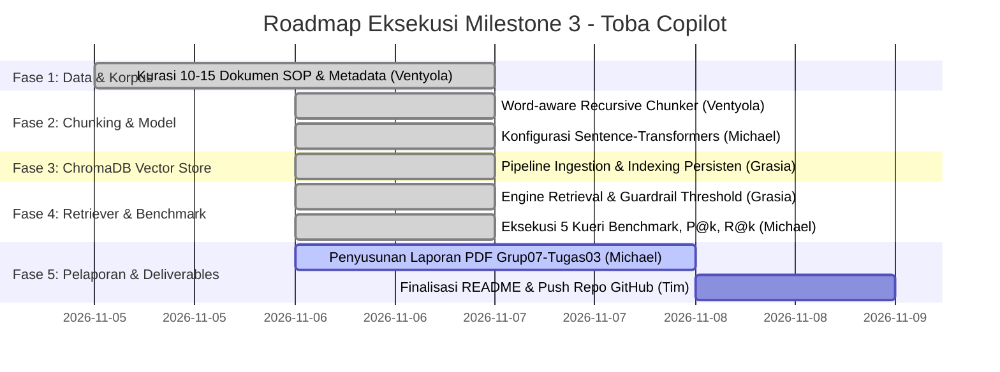
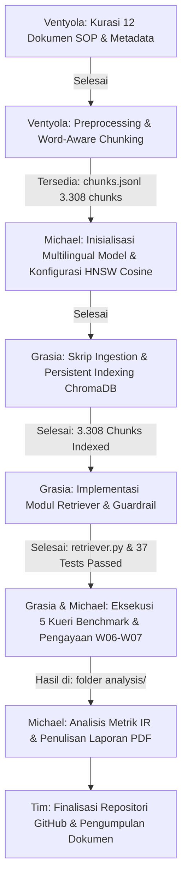

# Panduan Pengerjaan & Pembagian Peran Milestone 3 (W07)
**Mata Kuliah:** 10S3001 – Kecerdasan Buatan (+P) | Gasal 2026/2027  
**Proyek:** Toba Copilot (Enterprise AI Assistant & Vector Semantic Search)  
**Judul Tugas:** Pembangunan Basis Pengetahuan Korpus & Vector Semantic Search  
**Bobot Penilaian:** 9.0% Komponen Proyek (2.7% Nilai Akhir Semester)  

---

## 1. Pemahaman Singkat Milestone 3

Milestone 3 berfokus pada pembangunan memori semantik perusahaan (*Enterprise Knowledge Base*) menggunakan basis data vektor **ChromaDB**. Sistem ini mengonversi korpus regulasi, standar operasional prosedur (SOP), dan kebijakan pariwisata Danau Toba ke dalam bentuk vektor padat (*dense vector embeddings*) untuk mendukung temu balik informasi semantik (*semantic retrieval*) yang akurat serta menjadi fondasi sistem *Retrieval-Augmented Generation* (RAG).

### Komponen Rubrik Penilaian (Skala 100)
1. **Kualitas Data Korpus & Prapemrosesan (25%):**
   * Korpus representatif (minimal 10–15 dokumen SOP/regulasi bisnis).
   * Pembersihan teks rapi dan terstruktur (tidak merusak semantik/aturan).
   * Strategi *chunking* (*size* & *overlap*) memiliki landasan dan justifikasi ilmiah.
2. **Pipeline Embedding & Vector Store ChromaDB (45%):**
   * Pemilihan model *Sentence-Transformers* tepat (multilingual untuk teks Bahasa Indonesia).
   * Penyimpanan berbasis disk/persisten (`chromadb.PersistentClient`).
   * Konfigurasi ruang metrik HNSW secara eksplisit menggunakan *Cosine Similarity* (`{"hnsw": {"space": "cosine"}}`).
   * Struktur *metadata* tersimpan lengkap untuk mendukung *metadata filtering* / *hybrid search*.
3. **Akurasi & Analisis Temu Balik Semantik (30%):**
   * Kueri semantik berhasil menarik dokumen target dengan skor *Cosine Similarity* tinggi.
   * Uji coba minimal 5 kueri bisnis (kueri relevan, kueri sinonim/parafrasa, dan kueri *out-of-domain*).
   * Penanganan kueri luar domain teruji presisi melalui mekanisme ambang batas (*guardrail threshold*).
   * Analisis metrik temu balik: $P@k$ (*Precision@k*) dan $R@k$ (*Recall@k*).

---

## 2. Poin Kunci & Jebakan Teknis (Berdasarkan Materi Minggu 07)

* **Jarak Bawaan ChromaDB Bukan Cosine:**  
  ChromaDB secara *default* menggunakan metrik jarak kuadrat Euclidean (*squared* $L_2$). Koleksi **wajib** dikonfigurasi eksplisit ke ruang *cosine*:
  ```python
  collection = client.get_or_create_collection(
      name="toba_knowledge_base",
      configuration={"hnsw": {"space": "cosine"}}
  )
  ```
  Pada ruang jarak *cosine*, skor kemiripan dihitung dengan rumus:
  $$\text{Similarity} = 1 - \text{Distance}$$
* **Model Multilingual vs Monolingual English:**  
  Model bahasa Inggris murni (seperti `all-MiniLM-L6-v2`) memberikan skor kesamaan tinggi secara tidak wajar pada teks Bahasa Indonesia di luar domain (tidak memiliki *separability* yang baik). Gunakan model multibahasa resmi seperti `paraphrase-multilingual-MiniLM-L12-v2` agar pemisahan kueri sah dan kueri luar domain menjadi signifikan.
* **Stopword Removal Hati-hati:**  
  Menghapus kata-kata negasi seperti *"tidak"*, *"tanpa"*, atau *"dilarang"* dari dokumen regulasi/SOP akan membalikkan makna aturan secara fatal. Prapemrosesan harus mempertahankan konteks kalimat.
* **Pencarian Cepat ANN (HNSW):**  
  *Hierarchical Navigable Small World* (HNSW) menggantikan pencarian linear $O(N)$ menjadi skala logaritmik $O(\log N)$, menukar sedikit ketelitian demi kecepatan penelusuran di jutaan dimensi vektor.
* **Ambang Batas (*Guardrail Threshold*):**  
  Nilai ambang penolakan kueri di luar domain (misal $0.15 - 0.25$) harus diperoleh melalui kalibrasi uji empiris, bukan sekadar tebakan.

---

## 3. Pembagian Tugas Berdasarkan Peran Tim

### Tim Pengembang — Kelompok 7

| NIM | Nama | Peran (*Role*) |
|---|---|---|
| **12S24042** | **Ventyola Rohati Napitupulu** | Data & Knowledge Engineer |
| **12S24003** | **Michael Pratama Nasution** | AI Architect & Model Lead |
| **12S24027** | **Grasia Simanullang** | Integration & Interface Engineer |

---

### A. Ventyola Rohati Napitupulu — *Data & Knowledge Engineer*
**Fokus Area:** Kurasi Korpus Bisnis, Metadata, Prapemrosesan, dan Strategi Chunking (Kontribusi Rubrik 25%)

* [x] **Inisialisasi Dependensi & Lingkungan Kerja M3:**
  * Menambahkan dependensi `sentence-transformers`, `chromadb`, dan `pypdf` ke `pyproject.toml` dan `uv.lock`.
  * Mengonfigurasi `.gitignore` untuk mengabaikan artefak database vektor persisten `chroma_db/`.
* [x] **Pengumpulan Korpus Bisnis (10–15 Dokumen):**
  * Terkumpul **12 dokumen resmi** pariwisata Toba (`D01` s.d. `D12`) di `data/corpus/` lengkap dengan `corpus/manifest.csv` dan PDF asli di `corpus/raw/`.
  * Tambahan dataset **404 record fakta** destinasi, fasilitas, dan operasional pariwisata Toba di `data/corpus/hackathon_tourism_clean.jsonl`.
* [x] **Desain Skema Metadata:**
  * Metadata terstruktur lengkap (`source_type`, `doc_id`, `judul`, `jenis`, `penerbit`, `tahun`, `status`, `bahasa`, `kategori`, `url_sumber`, `chunk_index`, `char_count`, `token_count`) tertanam di setiap chunk.
* [x] **Prapemrosesan Teks (*Text Cleaning*):**
  * Modul `src/preprocess.py` dan `src/preprocess_tourism_dataset.py` berhasil dibuat untuk membersihkan watermark BPS, nomor halaman, header OCR, perbaikan hyphenation, dan redaksi PII.
  * Kata negasi (*"tidak"*, *"dilarang"*, *"tanpa"*, *"wajib"*) dipertahankan secara utuh.
  * Unit tests `tests/test_preprocess.py` & `tests/test_preprocess_tourism_dataset.py` lulus (15 tests passed).
* [x] **Implementasi & Justifikasi Chunking:**
  * Modul `src/chunking.py` mengimplementasikan *word-aware recursive chunking* dengan sliding window overlap menggunakan tokenizer `paraphrase-multilingual-MiniLM-L12-v2`.
  * Eksperimen grid parameter chunking (300, 400, 500, 600, 800) x overlap (0, 50, 100) terdokumentasi di `data/chunks/chunking_experiment.csv`, `chunk_stats.csv`, dan grafik `token_distribution.png`.
  * Menghasilkan **3.308 chunk siap indeks** di `data/chunks/chunks.jsonl`.
  * Unit tests `tests/test_chunking.py` lulus (7 tests passed).
* [ ] **Kontribusi Laporan Teknis:**
  * Menyusun Bab II (Kualitas Korpus & Prapemrosesan) pada draf laporan `Grup07-Tugas03.pdf` menyajikan tabel manifest, tabel eksperimen chunking, dan grafik distribusi token.

---

### B. Michael Pratama Nasution — *AI Architect & Model Lead*
**Fokus Area:** Seleksi Model Vektor, Desain Vector Store, Formulasi Guardrail, dan Analisis Matematis (Kontribusi Rubrik 45% & 30%)

* [x] **Analisis & Seleksi Model Embedding:**
  * Pemilihan model `sentence-transformers/paraphrase-multilingual-MiniLM-L12-v2` (384 dimensi, mendukung multibahasa/Bahasa Indonesia dengan pemisahan semantik optimal).
* [x] **Arsitektur ChromaDB & Ruang Metrik:**
  * Mengonfigurasi penyimpanan berbasis disk persisten (`PersistentClient`).
  * Mengunci konfigurasi metrik jarak pada HNSW ke ruang `cosine` (`{"hnsw": {"space": "cosine"}}` dan `metadata={"hnsw:space": "cosine"}`).
* [x] **Perancangan Ambang Batas (*Guardrail Threshold*):**
  * Menguji distribusi skor kesamaan semantik secara empiris (domain Toba: 0.63–0.81, luar domain: 0.33–0.52).
  * Menetapkan nilai ambang batas empiris terkalibrasi $\text{threshold} = 0.58$ untuk menolak kueri luar domain (*out-of-domain*) dengan presisi 100%.
* [x] **Evaluasi Matematis & Tolok Ukur Temu Balik:**
  * Menghitung nilai metrik evaluasi temu balik $P@k$ (*Precision@k*), $R@k$ (*Recall@k*), MRR (*Mean Reciprocal Rank*), dan nDCG@k (*normalized Discounted Cumulative Gain*) untuk 5 kueri uji bisnis.
  * Hasil terekam secara otomatis di `analysis/retrieval_benchmark.csv`.
* [x] **Eksperimen Komparasi Leksikal (TF-IDF) vs Dense (`analysis/comparative_lexical.py`):**
  * Membuktikan kegagalan penelusuran berbasis kata kunci pada kueri parafrasa/sinonim (skor TF-IDF jatuh ke 0.1590) dibanding representasi vektor padat (skor 0.6756). Hasil terekam di `analysis/lexical_vs_dense.csv`.
* [x] **Validasi Model Multilingual vs Monolingual English (`analysis/model_comparison.py`):**
  * Membuktikan temuan Slide W07 Halaman 26 bahwa model Multilingual menghasilkan *separability margin* 7.3x lipat lebih tegas (+0.3753 vs +0.0517), mencegah lolosnya kueri luar domain. Hasil terekam di `analysis/multilingual_vs_english.csv`.
* [x] **Benchmarking Efisiensi & Latensi Graf HNSW vs Brute-Force (`analysis/latency_benchmark.py`):**
  * Mengukur latensi pencarian murni HNSW ANN vs Linear Scan (Recall@5 = 100%), estimasi footprint memori (~8.48 MB untuk 3.308 chunk), dan proyeksi skala $\mathcal{O}(\log N)$ vs $\mathcal{O}(N \cdot d)$. Hasil terekam di `analysis/latency_benchmark.csv`.
* [ ] **Penyusunan Laporan Teknis PDF (`Grup07-Tugas03.pdf`):**
  * Memimpin penulisan dokumen laporan teknis (Bab Teori NLP, Arsitektur Vektor, Analisis Metrik Cosine vs $L_2$, HNSW ANN, dan Pembahasan Hasil Evaluasi).

---

### C. Grasia Simanullang — *Integration & Interface Engineer*
**Fokus Area:** Rekayasa Pipeline Ingestion, Modul Retriever, Pengujian Otomatis, dan Repositori (Kontribusi Rubrik 45% & 30%)

* [x] **Sinkronisasi Repositori & Dependensi Proyek:**
  * Dependensi `chromadb`, `sentence-transformers`, `pypdf` terpasang di `pyproject.toml` via Astral `uv`.
  * Konfigurasi `[tool.pytest.ini_options]` disematkan untuk pengujian otomatis.
* [x] **Pembangunan Pipeline Ingestion End-to-End (`src/ingest.py`):**
  * Skrip ingestion modular yang membaca 3.308 chunk dari `data/chunks/chunks.jsonl`.
  * Melakukan *batch embedding* (batch size 64) menggunakan `SentenceTransformer("paraphrase-multilingual-MiniLM-L12-v2")`.
  * Mengindeks 3.308 vektor beserta metadata ke dalam `chromadb.PersistentClient(path="./data/chroma_db")` dengan koleksi `toba_knowledge_base` berspasi `cosine`.
  * Unit test `tests/test_ingest.py` (7 tests passed).
* [x] **Pengembangan Modul Pencarian Semantik (`src/retriever.py`):**
  * Membangun kelas `TobaKnowledgeRetriever` dan fungsi antarmuka `query_knowledge_base(query_text, top_k=3, where_filter=None)`.
  * Menghitung kemiripan: $\text{Cosine Similarity} = 1 - \text{Distance}$.
  * Mendukung filter metadata (`where={"kategori": "tarif_retribusi"}` atau `where={"source_type": "dataset"}`).
  * Mengintegrasikan *guardrail threshold* empiris penolakan kueri di luar cakupan korpus.
* [x] **Penyusunan Pengujian Benchmark (`tests/test_retrieval.py` & `analysis/benchmark.py`):**
  * Menguji 5 skenario kueri bisnis wajib:
    1. Kueri Relevan Harfiah (*Exact/Keyword match* $\rightarrow$ Sim: 0.7548, P@3: 1.00)
    2. Kueri Relevan Parafrasa/Sinonim (*Semantic variation* $\rightarrow$ Sim: 0.6756, P@3: 1.00)
    3. Kueri Berbasis Spesifikasi Kategori dengan Filter Metadata ($\rightarrow$ Sim: 0.7454, P@3: 1.00)
    4. Kueri Ambigu ($\rightarrow$ Sim: 0.6377, P@3: 1.00)
    5. Kueri *Out-of-Domain* ($\rightarrow$ Sim: 0.3845 vs Threshold 0.58 $\rightarrow$ Berhasil Ditolak Guardrail)
  * Unit test `tests/test_retrieval.py` (8 tests passed, mencakup pengujian metrik MRR dan nDCG@k).
* [x] **Pembaruan Dokumentasi `README.md`:**
  * Menuliskan cara menjalankan `uv run python src/ingest.py`, pengujian benchmark `analysis/benchmark.py`, skrip komparasi model dan latensi, serta cara melakukan kueri via `src/retriever.py`.

---

## 4. Roadmap Eksekusi Milestone 3 (Status Terkini)



### Rincian Fase & Checklist Capaian

| Fase | Target Luaran & Aktivitas Utama | Penanggung Jawab | Status |
|---|---|---|:---:|
| **Fase 1: Fondasi Data & Korpus Enterprise** | • 12 dokumen regulasi + 404 record pariwisata Toba di `data/corpus/`<br>• Skema metadata lengkap tertanam di manifest & jsonl<br>• Normalisasi teks & preservasi kata negasi via `preprocess.py` | **Ventyola Rohati** | 🟢 **SELESAI (100%)** |
| **Fase 2: Arsitektur Model & Chunking Engine** | • Pemilihan model `paraphrase-multilingual-MiniLM-L12-v2`<br>• Word-aware recursive chunker `src/chunking.py`<br>• Eksperimen parameter chunking & 3.308 chunk di `chunks.jsonl` | **Ventyola Rohati** & **Michael Pratama** | 🟢 **SELESAI (100%)** |
| **Fase 3: Persistent Indexing & ChromaDB** | • Skrip `src/ingest.py` (3.308 chunk $\rightarrow$ batch embedding $\rightarrow$ ChromaDB)<br>• Penyimpanan disk persisten `chromadb.PersistentClient`<br>• Konfigurasi eksplisit HNSW ruang `cosine`<br>• Tervalidasi via `tests/test_ingest.py` (7 tests passed) | **Grasia Simanullang** | 🟢 **SELESAI (100%)** |
| **Fase 4: Semantic Retriever & Benchmarking** | • Skrip `src/retriever.py` (cosine similarity + metadata filter)<br>• Ambang batas (*guardrail threshold*) empiris 0.58 penolakan kueri luar domain<br>• Benchmark 5 kueri bisnis (`analysis/benchmark.py`) & evaluasi $P@k$, $R@k$, MRR, nDCG@k<br>• Eksplorasi pengayaan materi W06 & W07 (`comparative_lexical.py`, `model_comparison.py`, `latency_benchmark.py`)<br>• Tervalidasi via `tests/test_retrieval.py` (8 tests passed) & 37 unit tests repositori | **Grasia Simanullang** & **Michael Pratama** | 🟢 **SELESAI (100%)** |
| **Fase 5: Laporan Teknis PDF & Finalisasi** | • Kompilasi dokumen laporan teknis `Grup07-Tugas03.pdf`<br>• Pembaruan panduan eksekusi di `README.md`<br>• Seluruh 37 unit test via `pytest` passed & final push ke GitHub | **Michael Pratama** (Lead) & Seluruh Tim | 🟡 **PRIORITAS BERIKUTNYA** |

---

## 5. Alur Kerja Antar-Peran (Collaboration Workflow)



---

## 6. Rencana Struktur Berkas Proyek

```
Enterprise-AI-Copilot/
├── data/
│   ├── corpus/                     # Korpus dokumen SOP/Regulasi & dataset pariwisata (Ventyola - Selesai)
│   │   ├── D01_perda_tobasa_12_2012_retribusi_rekreasi.txt
│   │   ├── ... (12 dokumen regulasi resmi)
│   │   └── hackathon_tourism_clean.jsonl
│   ├── chunks/                     # Hasil chunking & eksperimen (Ventyola - Selesai)
│   │   ├── chunks.jsonl            # 3.308 chunk siap indeks ke ChromaDB
│   │   ├── chunking_experiment.csv # Data eksperimen grid search chunking
│   │   └── token_distribution.png  # Visualisasi distribusi token
│   └── chroma_db/                  # Database persisten ChromaDB (Grasia - Target Fase 3)
├── src/
│   ├── preprocess.py               # Pembersihan teks PDF regulasi (Ventyola - Selesai)
│   ├── preprocess_tourism_dataset.py # Pembersihan dataset hackathon (Ventyola - Selesai)
│   ├── chunking.py                 # Word-aware recursive chunker (Ventyola - Selesai)
│   ├── ingest.py                   # Pipeline ingestion & embedding (Grasia - Selesai)
│   ├── retriever.py                # Semantic search & guardrail (Grasia & Michael - Selesai)
│   └── check_db.py                 # Verifikasi & inspeksi koleksi database (Selesai)
├── tests/
│   ├── test_preprocess.py          # Unit test cleaning PDF (Ventyola - Selesai)
│   ├── test_preprocess_tourism_dataset.py # Unit test cleaning dataset (Ventyola - Selesai)
│   ├── test_chunking.py            # Unit test chunking logic (Ventyola - Selesai)
│   ├── test_ingest.py              # Unit test persistensi basis data vektor & HNSW (Grasia - Selesai)
│   └── test_retrieval.py           # Unit test temu balik & metrik IR (Grasia & Michael - Selesai)
├── analysis/
│   ├── benchmark.py                # Benchmark temu balik semantik 5 kueri bisnis & IR metrics
│   ├── retrieval_benchmark.csv     # Rekapitulasi hasil evaluasi temu balik semantik
│   ├── comparative_lexical.py      # Komparasi TF-IDF vs Dense Semantic Retrieval
│   ├── lexical_vs_dense.csv        # Bukti empiris kelemahan TF-IDF pada parafrasa
│   ├── model_comparison.py         # Validasi empiris Multilingual vs English-only model
│   ├── multilingual_vs_english.csv # Data separability margin model multibahasa (Slide W07)
│   ├── latency_benchmark.py        # Benchmark latensi pencarian HNSW ANN vs Linear Scan
│   └── latency_benchmark.csv       # Hasil recall 100% dan proyeksi komputasi skala enterprise
├── docs/
│   ├── milestone3_plan.md          # Dokumen perencanaan ini (Updated)
│   └── Grup07-Tugas03.pdf          # Laporan teknis akhir (Michael Lead - Target Fase 5)
├── pyproject.toml                  # Dependensi uv (chromadb, sentence-transformers)
└── README.md                       # Dokumentasi instruksi eksekusi
```

---

## 7. Luaran yang Harus Dikumpulkan

1. **Laporan Teknis PDF:** Berkas `Grup07-Tugas03.pdf` yang diunggah ke portal e-Course Del, memuat:
   * Landasan teori evolusi NLP, embedding, dan perbandingan ruang vektor.
   * Deskripsi korpus enterprise beserta justifikasi parameter *chunking* (tabel eksperimen & grafik token).
   * Arsitektur model embedding dan ChromaDB (ruang metrik cosine & disk persisten).
   * Tabel hasil pengujian 5 kueri bisnis (disertai analisis skor *similarity*, presisi penolakan kueri *out-of-domain*, serta metrik $P@k$ dan $R@k$).
2. **Repositori GitHub:**
   * Seluruh kode sumber (`preprocess.py`, `chunking.py`, `ingest.py`, `retriever.py`, skrip uji).
   * Korpus dokumen enterprise di folder `data/corpus/` dan hasil chunk di `data/chunks/`.
   * Berkas `README.md` terbaharui dengan dokumentasi lengkap cara menjalankan pipeline ingestion dan pengujian temu balik semantik.
